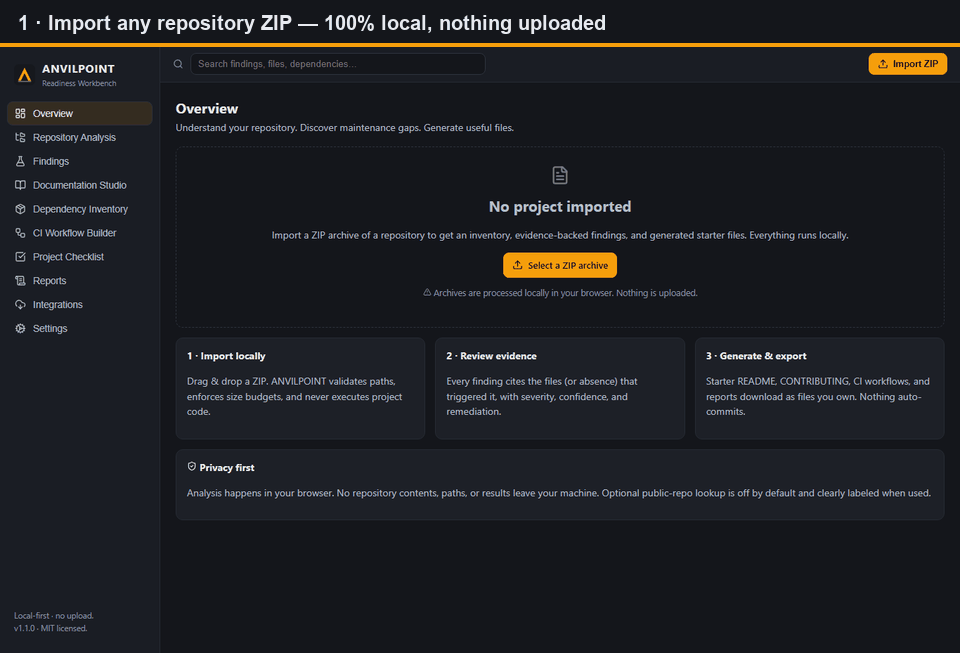
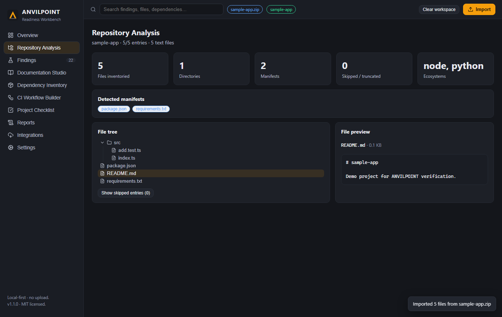
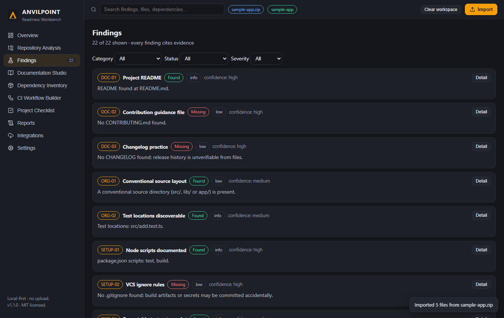

<div align="center">

# 🔨 ANVILPOINT

### The Open-Source Project Readiness Workbench

*Understand your repository. Discover maintenance gaps. Generate useful project files. Keep control of your code.*

[](https://github.com/shubhanand021-EXA/anvilpoint/actions/workflows/ci.yml)
[](LICENSE)
[](package.json)
[](CONTRIBUTING.md)
[](docs/PRIVACY.md)
[](docs/PRIVACY.md)



**100% local-first · Zero paid dependencies · Zero telemetry · MIT licensed**

[🚀 Quickstart](#-quickstart-windows-macos--linux) · [✨ Features](#-features) · [🔌 Integrations](#-enterprise-integrations-github--gitlab) · [🔒 Privacy & Security](#-privacy--security) · [🤝 Contributing](CONTRIBUTING.md)

</div>

---

## Why ANVILPOINT?

Every week, thousands of developers publish repositories missing a README, a license, tests, or CI — not from laziness, but because professional setup takes time and tooling. ANVILPOINT compresses that work into minutes:

| Before | With ANVILPOINT |
|---|---|
| "Is this repo ready to publish?" 🤷 | A **47-point readiness score** with transparent methodology and per-category breakdown |
| Manually auditing docs, CI, licenses | **22+ evidence-backed checks** across 12 categories — every finding cites its files |
| Blank-page syndrome writing README/CONTRIBUTING/CI | **One-click starter docs & workflows** prefilled from verified facts, `[TODO]` where *you* must decide |
| "Can I trust this tool with my code?" | **Local-first**: ZIPs never leave your browser; optional cloud connects are explicit and token-safe |

> **Honest by design.** ANVILPOINT never executes your code, never queries vulnerability databases, never claims legal compliance, and never disguises heuristics as certifications. What it can't verify, it says so.

---

## ✨ Features

### 📦 Repository Import & Inventory
Drag & drop any `.zip` — path-traversal and absolute paths rejected, size/entry budgets enforced, binaries detected by content sniffing, oversized files truncated (never crashing). You get a file tree, text preview, manifest detection, and a full accounting of **what was skipped and why**.

### 🔍 Multi-Ecosystem Analyzer
Detects **Node.js, Python, Rust, and Go** projects (including monorepos with nested manifests) and runs a rule engine producing findings like:

```
DOC-01  Project README .................. FOUND      README.md
LIC-01  License file evidence ........... MISSING    (no license file) → add MIT LICENSE
SEC-01  Security reporting policy ....... MISSING    (no security.md) → generate one
TEST-01 Repeatable test entry point ..... FOUND      package.json#scripts.test
```

Each finding carries severity, confidence, evidence paths, remediation, and its verification method.

### 📝 Documentation Studio
10 templates — README, CONTRIBUTING, SECURITY, Code of Conduct, CHANGELOG, issue/PR templates, dev-setup, release checklist. Fields prefill from **verified** repo facts; everything uncertain is an explicit `[TODO]`, never an invented command. Preview → copy → download singly or as a ZIP bundle.

### 📚 Dependency & License Inventory
Parses `package.json`, `requirements.txt`, `pyproject.toml`, `Cargo.toml`, `go.mod`. Version ranges are shown as ranges (never as installed versions); licenses are labeled `unknown — review` unless declared. No fake vulnerability claims, ever.

### ⚙️ CI Workflow Builder
Reviewable GitHub Actions starters per ecosystem with pinned action versions, minimal `contents: read` permissions, and honest "verify each command" notes. Preview before you commit — ANVILPOINT never commits anything.

### ✅ Checklist, 📊 Reports, 🔎 Search
Findings become prioritized tasks (user-marked vs. verified stays distinct). Export **JSON / Markdown / CSV**. Global search filters real findings, files, and dependencies — no hard-coded demo rows.

---

## 🔌 Enterprise Integrations — GitHub & GitLab

ANVILPOINT is local-first, but real teams live on hosted platforms. The **Integrations** page offers optional live connections:

- **GitHub** — enter `owner/repo` (or paste a URL). Default branch auto-detected via API; `codeload` archive download. Unauthenticated 60 req/hr shown live; add a PAT for private repos + higher limits.
- **GitLab** — `namespace/project` or URL, any self-hosted host, `PRIVATE-TOKEN` supported.
- **Token safety** — tokens live in **memory only**, sent solely to the host you chose, with show/hide + one-click discard. Never persisted, never logged.
- **Same guarantees** — downloaded archives pass through the identical safety validation; analysis still runs locally afterwards.
- **Project history (opt-in)** — metadata-only log (name, score, date, source) on your device. Source contents are never stored.

```text
You → Integrations → owner/repo → [Fetch & analyze] → local pipeline (validate → parse → rules → score)
                                        ↑ token in memory only, https to github.com, user-initiated
```

---

## 🚀 Quickstart (Windows, macOS & Linux)

**Prerequisites (all free):** [Node.js LTS v20+](https://nodejs.org/) + npm 10+, a modern browser.

```bat
REM Windows — from the project folder:
start.bat
REM → opens http://localhost:5173
```

```bash
# Any OS:
npm ci          # pinned, reproducible install
npm run dev     # dev server → http://localhost:5173
npm test        # unit + integration tests
npm run typecheck
npm run build && npm run preview   # production build
```

> Offline? After `npm ci`, everything except the *optional* Integrations page works with no network at all.

## 🖥️ Desktop app (Windows)

Prefer a real app over a browser tab? Every release ships both:

- **`Anvilpoint-Setup-<version>.exe`** — NSIS installer (per-user, no admin needed)
- **`Anvilpoint-Portable-<version>.exe`** — zero-install portable build

Download from the [**Releases page**](https://github.com/shubhanand021-EXA/anvilpoint/releases),
or build it yourself with `npm run dist:win`. The desktop shell is a sandboxed
Electron wrapper around the same audited bundle — still local-first, still no telemetry.
Details, SmartScreen notes, and security posture: [`docs/DESKTOP.md`](docs/DESKTOP.md).

---

## 🏗️ Architecture

```mermaid
flowchart LR
    A[ZIP drop / GitHub / GitLab] --> B[Validate: paths, budgets, types]
    B --> C[Inventory + manifest parsers]
    C --> D[Rule engine: evidence-backed findings]
    D --> E[Transparent scoring]
    E --> F[Docs Studio · CI Builder · Checklist · Reports]
    style B fill:#1a1d24,stroke:#f59e0b
    style D fill:#1a1d24,stroke:#f59e0b
```



Local-first React + TypeScript frontend, zero backend. Core logic (`src/core/`) is UI-independent and fully unit-tested. Full details: [`docs/ARCHITECTURE.md`](docs/ARCHITECTURE.md) · [`docs/SCORING.md`](docs/SCORING.md) · [`docs/PRIVACY.md`](docs/PRIVACY.md).

---

## 📸 Screenshots

| Analysis | Findings |
|---|---|
|  |  |

---

## 🔒 Privacy & Security

- **No uploads, no accounts, no telemetry.** See [`docs/PRIVACY.md`](docs/PRIVACY.md).
- Untrusted archives treated as hostile: traversal/absolute-path rejection, decompression budgets, binary sniffing — all covered by security tests.
- Findings are heuristic file-presence checks, **not** a security audit. [`SECURITY.md`](SECURITY.md) explains reporting.

---

## 🗺️ Roadmap

- [ ] Playwright end-to-end suite (screenshots already automated via `scripts/shots.cjs`)
- [ ] More ecosystems (Java/Maven, Ruby, PHP) behind the same evidence bar
- [ ] Optional OSV.dev advisory lookup — explicit opt-in, rate limits disclosed
- [ ] Organization-wide readiness dashboards from exported JSON reports

---

## 🤝 Contributing

Small, focused PRs. Core logic needs tests; no paid deps, no telemetry, no fake passes. Start here: [`CONTRIBUTING.md`](CONTRIBUTING.md) · [`CODE_OF_CONDUCT.md`](CODE_OF_CONDUCT.md) · [`docs/RELEASE_CHECKLIST.md`](docs/RELEASE_CHECKLIST.md)

## 📄 License

MIT © 2026 ANVILPOINT contributors — see [`LICENSE`](LICENSE). Third-party attributions: [`THIRD_PARTY_NOTICES.md`](THIRD_PARTY_NOTICES.md).

---

<div align="center">

**Built in the open. Your code never leaves your machine.** 🔨

⭐ Star this repo if ANVILPOINT helped you ship a better README.

</div>
